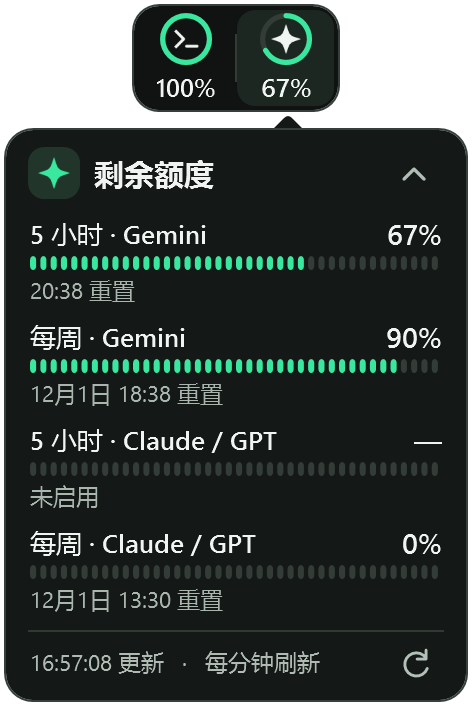

# DualMeter · 双额度悬浮窗

在 Windows 桌面同时查看 Codex 和 Google Antigravity 的剩余额度。两个圆环每分钟独立刷新，点开其中一个就能查看该服务的额度周期和本地重置时间。



图中使用示例读数。左侧终端图标显示 Codex 返回的最短已知周期。账号若只有每周额度，这里就显示每周余额。右侧星形图标显示 Gemini 的 5 小时余额。展开后还可看到服务返回的每周额度，以及 Antigravity 的 Claude/GPT 额度和启用状态。

## 开始使用

1. 在 Windows 10 或 11 上准备 .NET Framework 4.8 或更高版本。
2. 安装并登录要查看的客户端。Codex 需要支持额度查询的桌面客户端或 CLI，并使用 ChatGPT 账号登录。Antigravity 需要已登录的 `agy` CLI 1.1.11 或更高版本，可在终端运行 `agy --version` 检查。
3. 从 [Releases](https://github.com/DengyingFu/DualMeter/releases/latest) 下载 `DualMeter.exe`，放入常用应用目录，双击运行。两个服务可以单独使用，某一端暂时不可用时，另一端会继续更新。

| 操作 | 效果 |
| --- | --- |
| 单击圆环 | 展开对应服务，再点一次圆环或点击其他应用即可收起 |
| 按住任一圆环拖动 | 可拖到桌面工作区边缘，松手后记住位置。靠近底部时，详情向上展开 |
| 按 F5 或点击详情右下角的刷新按钮 | 立即更新 |
| 按 Esc | 收起详情 |
| 右键悬浮窗或托盘图标 | 调节背景透明度（0%–100%）、刷新、隐藏到托盘或退出。圆环、图标和文字保持清晰 |
| 单击托盘图标 | 显示悬浮窗。隐藏后也可以从托盘右键菜单恢复 |

## 额度从哪里来

DualMeter 调用本机已登录的客户端。Codex 通过 `codex app-server` 的 `account/rateLimits/read` 接口返回额度。Antigravity 通过 `agy` 的内置 `/usage` 命令返回额度。客户端可能需要联网。查询失败时，窗口会提示错误，并保留上次成功的读数及时间。

额度读数只保存在内存中。DualMeter 在 `%LOCALAPPDATA%\DualMeter` 目录下用 `position.txt` 保存窗口位置，用 `transparency.txt` 保存背景透明度，下次启动时会恢复这两项设置。

## 从源码构建

在仓库根目录使用 Windows PowerShell 5.1 或 PowerShell 7 运行：

```powershell
powershell -NoProfile -ExecutionPolicy RemoteSigned -File .\build.ps1
.\dist\DualMeter.exe
```

脚本使用 .NET Framework 自带的 C# 编译器和 WPF 程序集，图标与 XAML 会嵌入生成的单文件程序。若想在自己的构建中换图标，可替换 `src/CodexMark.png` 和 `src/AntigravityMark.png`，保留透明背景后重新构建。

## 许可证

代码与随仓库提供的原创图标使用 [MIT 许可证](LICENSE)。DualMeter 是独立社区工具。Codex 和 Antigravity 的产品名称归各自权利人所有。
